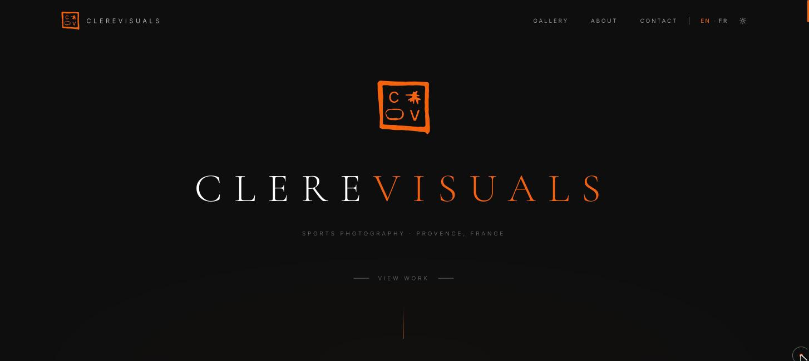

# Clerevisuals

**Live: [clerevisuals.fr](https://clerevisuals.fr)**

Portfolio site for Clerevisuals, my sports and event photography business in Provence, France.
It is a one-page site with French and English versions and light and dark themes, built to be sent to clubs, circuits and brands.



## Highlights

- **React 18 + Vite + Tailwind CSS**, with **GSAP** and **Lenis** for scroll-driven motion, a custom cursor and an intro sequence that only plays on the first visit.
- **Filterable gallery** (track and field, motorsport, cycling, landscape) with a full-screen lightbox.
- **Bilingual and themeable**: FR/EN and light/dark, through React contexts.
- **Image pipeline** (`npm run images`): a Node script built on **sharp** turns full-resolution originals into three WebP sizes (640, 900 and 2200 px). It also regenerates the photo catalogue, with real aspect ratios to avoid layout shift, and the sitemap. Album counts are never maintained by hand.
- **Performance**: self-hosted fonts, the stylesheet inlined into the HTML and right-sized images for every slot.
- **Security headers** (CSP, Referrer-Policy, Permissions-Policy) shipped in `public/_headers`, so that every deploy carries them.
- **SEO**: canonical URL, Open Graph card, JSON-LD and a generated sitemap.
- Deployed on **Netlify**.

## Tech stack

| | |
|---|---|
| UI | React 18, Tailwind CSS |
| Motion | GSAP, Lenis |
| Build | Vite |
| Images | sharp (Node), WebP |
| Hosting | Netlify |

## Getting started

```bash
npm install
npm run dev      # http://localhost:5173
```

## Adding or changing photos

Photos live in **two** places, and this is the one thing to understand about
the project:

| Where | What | In git? | Served? |
|---|---|---|---|
| `photos-source/<album>/` | full-res originals, the archive | no | never |
| `public/images/<album>/thumbs/` | 900 px WebP, for grids and covers | yes | yes |
| `public/images/<album>/thumbs-md/` | 640 px WebP, the same grids in smaller slots | yes | yes |
| `public/images/<album>/large/` | 2200 px WebP, for the lightbox | yes | yes |

To add photos:

1. Drop the full-res files into `photos-source/<album>/`, named `01.jpg`,
   `02.jpg`, … (zero-padded, sorted by name).
2. Run the pipeline:

```bash
npm run images
```

That rebuilds only what changed and rewrites three files:
`src/data/photos.generated.js` (the catalogue — album contents and real aspect
ratios), `public/sitemap.xml`, and the derivatives themselves. Album counts are
never maintained by hand.

`photos-source/` is not in the repo, so **keep your own backup of it**. Losing
it means losing the originals; the site would keep working off the derivatives.

### Captions

Photos show their album name by default. To caption a specific one, add an
entry to `src/data/captions.js` keyed by `<album>-<position>` (`tf-003`):

```js
'tf-003': {
  title:    'Sprint Finish',
  location: 'Aix-en-Provence',
  alt:      'Sprinter crossing the line, arms raised, evening light',
},
```

The hand-picked "My Favorite Work" grid is a separate list in
`src/data/featured.js`.

### One-off images

The images that aren't part of an album are listed in `SINGLES` at the top of
`scripts/gen-images.mjs`: the social card (`og-cover.jpg`, 1200x630 JPEG, the
size every scraper crops to) and the About portrait (`portrait.webp` plus a
narrow `portrait-sm.webp` for phones). Change a `source` there and re-run
`npm run images`.

The hero is not one of them — it comes straight from an album, like any other
photo on the page.

## Deploying

Netlify, configured in `netlify.toml` (build command, security headers, cache
policy). The production URL is `https://clerevisuals.fr` — it also appears in
`index.html` (canonical, Open Graph, JSON-LD), `public/robots.txt` and
`SITE_URL` in `scripts/gen-images.mjs`. Change it in all four if the domain
ever changes.

```bash
npm run build    # → dist/, about 53 MB, the vast majority of it photographs
```
